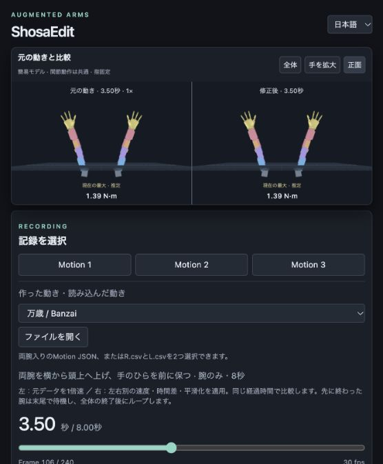
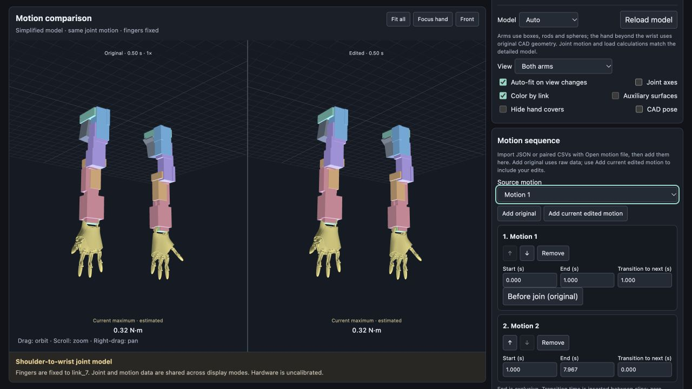
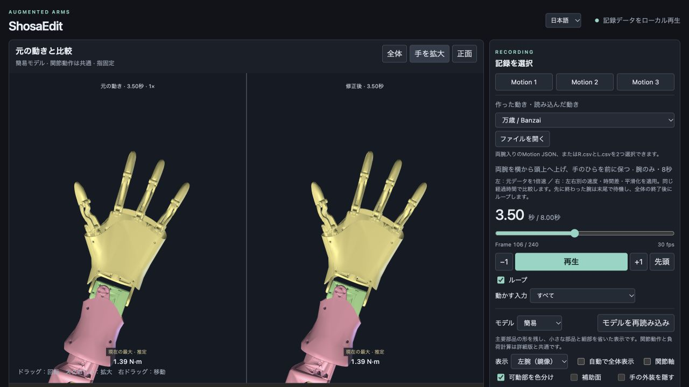

# ShosaEdit

[日本語](README.md) | English

ShosaEdit is a local web app for replaying recorded robot-arm motions in 3D and editing each arm's speed, delay, and smoothing while comparing the result with the original. You can save edited motions under new names or export them in the original CSV format.

The repository runs with a coarse simplified model and motion data. Detailed CAD is obtained separately and kept locally. The interface supports Japanese and English. The screenshots below show the Japanese interface; use the language selector to switch to English.



The left pane shows **the original motion of both arms**; the right pane shows **the edited motion of both arms**. Right-arm and left-arm speed settings refer to the robot's arms, not the two comparison panes.

## Getting started

You need **Python 3** and a **WebGL-capable browser**. Normal use does not require Node.js or package installation.

```sh
git clone https://github.com/soheiw/shosaedit.git
cd shosaedit
python3 launch.py
```

The launcher opens your browser automatically. On macOS, you can also double-click **起動.command** in the project folder.

- The usual URL is `http://127.0.0.1:8765/`.
- If another app occupies the port, the launcher uses an available port. Open the URL printed in the terminal.
- Press `Ctrl+C` in the terminal to stop the server.
- Use the local server rather than opening the HTML file directly.

To start without opening a browser and specify a preferred port:

```sh
python3 launch.py --no-browser --port 8765
```

The model, rendering libraries, and motion data are bundled. Playback and editing run locally. The app does not connect to physical actuators.

## Basic workflow

1. Choose **Motion 1–3** or an entry under **Generated and imported motions**. The library also includes 17 generated motions, such as banzai, waves, bird flapping, and a hug.
2. Play the motion or seek with the playback slider. The original in the left pane plays at 1×; the edited motion in the right pane uses your settings.
3. Adjust each arm's speed, Bézier curve, delay, and smoothing.
4. Use **Save as new motion** to add the result to the list, or export the right/left CSVs.

The 3D view stays visible while scrolling. Playback does not automatically move the camera.

| Control | Action |
| --- | --- |
| Drag | Orbit the camera |
| Scroll | Zoom |
| Right-drag | Pan |
| Fit all | Fit the current pose in the view |
| Focus hand | Zoom in on the hand area |
| Front | View from the front of the body |
| Space | Play/pause when a form field is not focused |
| ← / → | Step backward/forward by one frame of elapsed time |

If a pose extends outside the view, press **Fit all** at that pose.

## Independent arm speeds and delay


By default, the right and left arms have separate settings.

- **Playback rate:** Set each arm to 0.25–3×.
- **Bézier speed curve:** Choose the target with **Edit arm**, then drag points and handles. You can also edit the selected point numerically. The horizontal axis is source time; the vertical axis is the speed multiplier. A flat 1× curve means constant speed.
- **LINK:** Enable shared playback-rate and curve settings. Turning LINK off restores the individual arm settings.
- **Arm delay:** Choose which arm to delay and enter 0–5 seconds. The delay is measured in actual output seconds, after applying the speed curve.

The effective speed is the arm's playback rate multiplied by the curve value. **Reset to constant speed** resets the selected curve to a flat 1× without changing the arm's playback rate. Delay remains independent of LINK.

An arm waiting to start holds its first pose; an arm that has finished holds its last pose. Looping restarts after both the original and edited playback have finished.

The playback slider and load graph use **actual elapsed time**. The motor-position graph uses **source time**. Speed and delay settings are automatically saved in the browser for each motion.

## Smoothing

| Method | Adjustment |
| --- | --- |
| Adaptive (preserve sharp motion) | Uses sustained motion, reversals, and coordinated joint changes as cues to reduce smoothing where motion should be preserved. Adjust it with **Strength**. |
| Gaussian time averaging | Averages neighboring samples using Gaussian weights. Adjust **Time window (full width)** in seconds. |

Use **Protect a time interval** to preserve a section of motion. Smoothing windows and protected intervals refer to source time. Adaptive detection is an estimate and cannot guarantee preservation of the intended gesture; check the comparison view.

## Save an edited motion under a new name


Under **Save or export edited motion**, enter a name and press **Save as new motion**.

- A new 30 fps motion is created with both arms' rates, speed curves, delay, and smoothing applied.
- It is added to the dropdown and selected. The original remains available. Duplicate names receive a numeric suffix.
- The motion is stored in the browser's IndexedDB and remains available after reloading.
- A **Motion JSON** file is downloaded at the same time.

Edits are baked into the saved samples. On first selection, the saved motion opens at **1× speed, no delay, and smoothing off**, so the edits are not applied twice. This saves the resulting motion, not the editing history or original Bézier control points. You can edit the saved motion further.

**The browser's motion list and the downloaded file are separate.** Clearing site data removes the saved list. A different browser or URL port uses a different storage area. Keep the JSON file for backup or transfer, and reload it with **Open motion file**.

## Panels and recording slots

Click each panel heading to collapse or expand it; this browser remembers the state. The timeline, playback controls and loop toggle stay below the fixed 3D view.

Recording buttons cover Motion 1–9. Slots 4–9 start empty. Choose a slot in **Import recording into**, then open a Motion JSON or paired CSV files to register it persistently in this browser.

Detailed display loads the right arm from `private-model/model.json` and `model.bin`, and the actual left arm from `private-model/left-model.json` and `left-model.bin`. Left geometry is independently partitioned from its Fusion CAD, including the different hand. Simplified display uses `public-left-hand.js` for the actual left hand, with primitive arms. A missing-left fallback is explicitly labeled as mirrored right geometry.

Left-hand-specific mass, COM and inertia have not yet been integrated; shared provisional load settings remain in use. Geometry integration does not validate physical joint ranges, cable clearance or motor signs.

## Live torque graph

The fixed charts below playback show estimated absolute torque (N·m) for seven joints on each arm, a moving playback cursor, and current values. Click a graph to seek. Select one joint to show its configured limit and warning threshold; enable **Original (dotted)** to compare. Stale graphs disappear during recalculation. Values are estimates, not measurements.

## OSC / UDP streaming to TouchDesigner

In **OSC / UDP**, set the receiving PC's IP and port, then start streaming. Run through `python3 launch.py`; restart older servers to enable the relay. The destination is saved locally, but streaming never resumes automatically. Both arms share sequence numbers, approximately 30 fps; paused playback sends held values. Browser scheduling and background throttling affect cadence. Slow requests skip frames rather than queueing them.

In TouchDesigner, use [OSC In CHOP](https://derivative.ca/UserGuide/OSC_In_CHOP), set **Network Port** to match, and enable **Active**. Network reachability and UDP firewall permissions are required. A successful send means the local OS accepted the datagram, not that TD received it.

| OSC address | Value |
|---|---|
| `/shosaedit/R/count/1`–`9`, `/shosaedit/L/count/1`–`8` | Edited integer motor counts, including finger columns |
| `/shosaedit/R/angle/1`–`7`, `/shosaedit/L/angle/1`–`7` | Calibrated joint angles, radians |
| `/shosaedit/R/torque/1`–`7`, `/shosaedit/L/torque/1`–`7` | Signed estimated torque, N·m |
| `/shosaedit/R/load_valid`, `/shosaedit/L/load_valid` | 1 when calculated; 0 during recalculation, with torque messages omitted |
| `/shosaedit/time`, `/shosaedit/playing`, `/shosaedit/sequence` | Elapsed seconds, playing 1 / paused 0, frame sequence |

Each address has one numeric argument. Frames use two OSC bundles (one per arm), each at most 1400 bytes. Streamed data includes speed, arm delay and smoothing, independent of display-only CAD pose or isolated-input controls. Streaming continues through load errors like the preview; it does not control motors or establish hardware safety.

Relay checks: `python3 tests/test_osc_bridge.py` validates OSC contents, loopback UDP reception and same-origin HTTP restrictions.

The six original CSV files for Motion 1–3 are preserved byte-for-byte in `motion-data/original-csv/`.

All bundled motion data lives in `motion-data/`: `motions.json` contains original Motion 1–3, `*.motion.json` contains generated motions, and `generated-motions.json` is the catalog.

## Joining separate recordings

Use **Motion sequence** to arrange multiple recordings into one motion.

1. Import each Motion JSON or paired right/left CSV using **Open motion file**. Original recordings, generated motions and saved motions are also available.
2. Select a source and click **Add original** for raw data, or **Add current edited motion** to bake the current speed, delay and smoothing into a copied segment.
3. Use ↑ / ↓ to reorder. Set start and exclusive end times in seconds. Choose **Overlap blend** or **Insert transition**, then set 0–10 seconds; zero makes a direct cut. No transition follows the last clip.
4. Click **Preview sequence**. **Before join (original)** seeks about 0.5 seconds before a join on the original sequence clock. Independent speed or delay edits may place edited-arm joins at other elapsed times.
5. Enter a name and click **Save sequence** to add it to the motion list and download a Motion JSON. Existing right/left CSV and ZIP exports work on the result.

The arrangement, trims and copied source data are saved as a draft in this browser and restored after reload. Drafts do not carry across browsers or ports, and clearing site data removes them. Exported JSON contains the flattened sequence; keep original capture files separately.

Sources must share motor columns and reference poses. Calibration alignment, IK and collision avoidance are not automatic. Joins interpolate every motor channel with quintic smoothstep; recorded boundary velocities are not necessarily continuous, so inspect and adjust trims and transition time in the preview. Original recordings remain unchanged. Limits: 50 clips and 10,000 output frames (about 333 seconds).


Choose **Overlap blend** or **Insert transition** for each join. Overlap blends the moving tail of one clip with the moving head of the next using quintic smoothstep; total duration shrinks by the overlap length. Set the shared capture interval manually; phase alignment is not automatic. One-frame overlaps and conflicting incoming/outgoing overlaps are rejected.

**Fill manufacturer stall torques (provisional)** fills all 12 confirmed axes using the voltage selected in the specification table. Defaults: XM540 7.3 N·m at 12 V, XM430 4.1 N·m at 12 V, XC330 0.92 N·m at 11.1 V. Joint 5 remains unchanged because its model is unconfirmed. Provisional labels and voltages persist. Reapply after changing voltage. Stall values are comparison thresholds, not continuous operating limits.

Enter each axis limit directly as **stall %** to calculate N·m using its saved voltage basis: 50% of 7.3 N·m is 3.65 N·m. Editing N·m updates the percentage too. Unknown models cannot use percentage entry. The separate WARNING percentage remains relative to the configured limit, not the stall torque.

Set each motor's allowable torque in N·m in the 14-axis **Estimated loads** table. The warning percentage defaults to 80% and is editable. Exceeding a motor limit produces ERROR; exceeding the warning percentage produces WARNING. A stage banner reports the whole edited motion and recalculates after timing or smoothing edits. Saving, CSV/ZIP export and sequence saving recheck the exact output at 30 Hz and reject any configured motor overload. Warnings allow output. Unset limits remain unassessed and do not block output. Finger drives are excluded. These model estimates include mass and inertia; they do not establish hardware safety.



## Import files and export CSVs

**Open motion file** accepts either of the following:

| Format | Contents |
| --- | --- |
| Motion JSON | One ShosaEdit motion file containing both arms, with `format: augmented-arms-motion`, `version: 1`, and `fps: 30`. |
| CSV pair | Select matching `MotionNameR.csv` and `MotionNameL.csv` files together. No header, integer values, 9 columns for the right arm and 8 for the left. |

Imports support files up to 6 MB each and 2–10,000 frames per arm. To keep an imported motion in the browser's list across reloads, save it under a new name.

CSV exports use **30 fps, no header, integer motor counts, 9 right-arm columns, and 8 left-arm columns**. Save either arm separately or download the pair as a ZIP. Both CSVs have the same number of rows, extending until both edited arms finish. Waiting periods contain the first or last sample as appropriate. Finger columns are included. Display-only CAD pose and input isolation do not affect exports. Original files are unchanged.

## Per-motor loads and limits


**Per-motor limit comparison** lists **all 14 modeled shoulder-to-wrist axes across both arms**. R1–R7 and L1–L7 number joints from the shoulder; they have not been matched to hardware motor IDs. Finger drives are excluded.

- Each axis shows the edited **current torque**, **peak torque (original → edited)**, and **RMS torque**.
- Enter an **allowable operating torque in N·m** for each arm axis to see the edited peak-to-limit ratio and time above the limit.
- **If any single axis exceeds its limit, the whole motion is flagged.** Low loads on other axes do not cancel the exceedance.
- **Go to highest ratio** selects the motor with the highest peak-to-limit ratio and seeks to that time. Each motor's button also selects its individual graph.
- If no axis exceeds a limit but some limits are missing, the result is **Incomplete**. A within-limits result is shown only when all 14 limits are set and none is exceeded.

Limits are saved in the browser and shared across motions. Clear an input to unset its limit. Stall torque is not automatically used as a continuous operating limit. Comparisons use the absolute torque including gravity and motion; time above a limit is calculated by linear interpolation between analysis samples.

This is a comparison of estimated torque for motion review. It does not reproduce hardware current, temperature, or protective shutdown logic, and it does not automatically stop hardware or preview playback.

## Estimated load comparison

Joint torque from gravity and motion is estimated using CAD geometry, manufacturer motor masses, and assumed component masses. The individual graph compares the selected motor's peak torque, RMS torque, and time integral of torque squared over the **same comparison duration** for original and edited motion. Holding the final pose includes gravity load.

- Printed parts provisionally use PLA density of 1.24 g/cm³, 20% infill, and 1.2 mm shell thickness. These are not measured masses.
- Adjust the assumptions and payload masses under **Mass and center of mass**.
- Load colors are relative within the comparison, not percentages of motor ratings.
- The time integral of torque squared is a comparison metric, not heat or energy consumption.

Hardware joint limits, calibration, cables, and whole-arm collisions during motion remain unverified. Estimated loads and visual consistency do not constitute hardware safety validation.

## Simplified display and optional detailed CAD

Use **Model → Auto / Simplified / Detailed CAD**. Auto displays detailed CAD when available and otherwise uses the simplified model. The simplified arms combine boxes, rods and spheres; the hand retains its original CAD geometry, preserving approximate placement, size and thickness. Holes, indentations and small hardware are omitted. The face with two small motors is the palm. Joint axes, hierarchy, reference angles, motions, and CSV exports remain identical across display modes. Detailed appearance and geometric collisions are not reproduced by the proxies.

Full-arm detailed CAD is excluded from GitHub. Wrist-distal geometry (link_7) is included with explicit authorization for public distribution. Obtain this app's exported CAD pair separately, place it here, and click **Reload model**:

```text
private-model/
  model.json
  model.bin
  mass-shapes.json  # optional: recalculate masses from material settings
```


Both `model.json` and `model.bin` are required. This is not a generic STL or Fusion importer. Selecting Detailed CAD without the files keeps the simplified model visible and displays: **You need to put model.json and model.bin in the private-model/ directory to display detailed CAD.**

The private-model data files are Git-ignored. Do not force-add them. Previously committed CAD geometry and CAD screenshots have also been removed from main's history. Collaborators with older clones should clone the repository again.

Load estimates retain the same aggregate link masses, centers of mass, and inertia tensors. They do not derive mass from the simplified display geometry. Manual link mass/COM editing works without CAD; material-based recalculation requires the optional `mass-shapes.json`.



## Model and joint assumptions

- The joint model uses `link_0`–`link_7`. Fingers and tendon-related parts are fixed to `link_7`.
- The left arm is a provisional mirror of the right. Optional local CAD restores the original component shapes.
- Input columns 1–7 drive the shoulder-to-wrist joints. Columns 8/9, where present, are retained and exported but do not animate fingers.
- The side with two small visible motors is the palm. **Hide hand covers** helps inspect this identifying feature.
- **Joint mapping and reference pose** lets you change input IDs, rotation directions, axes, and reference angles. Physical calibration is still required.

This preview targets the bundled model. It currently does not include direct import of arbitrary Fusion files or URDFs, hardware control, motion-capture input, or in-app AI generation from natural language.

## Development and checks

Rendering and editing use JavaScript and Three.js. Local serving uses Python's standard library. There is no build step.

Checks require Node.js 20 or later. No external packages need to be installed.

```sh
npm test
```

Checks cover independent playback clocks, delay, CSV sampling, LINK switching and settings restoration, load calculations, endpoint holds, and 14-axis limit assessment including exceedance duration and highest-ratio selection. Numerical checks are separate from CAD visual inspection and physical validation.

| File | Role |
| --- | --- |
| `app.js` / `index.html` / `style.css` | Interface and playback |
| `speed-curve.js` / `arm-delay.js` / `smoothing.js` | Speed, delay, and smoothing |
| `motion-sequence.js` / `sequence-editor.js` | Clip trimming, joins and sequence drafts |
| `saved-motions.js` / `motion-files.js` / `export-motion.js` | Named saves, import, and export |
| `load-physics.js` / `load-panel.js` / `mass-model.js` / `motor-loads.js` | Load estimation and mass model |
| `simple-model.js` / `simple-primitives.js` / `model-loader.js` | Primitive geometry and optional local CAD |
| `public-hand.js` | Publicly authorized wrist-distal CAD (link_7) |
| `mass-properties.json` | Aggregate link mass, COM, and inertia without surface geometry |
| `private-model/README.txt` | Instructions for separately obtained CAD |
| `motion-data/motions.json` / `motion-data/*.motion.json` | Original recordings and generated motions |
| `tests/` | Numerical and settings checks |

See the [motion re-audit record](docs/motion-reaudit.md) for the scope of earlier motion reviews and the [gesture research notes](docs/shosa-research.md) for the design background. These supporting documents are currently in Japanese.

## Licenses and data

The Three.js license is in [`vendor/LICENSE-three.txt`](vendor/LICENSE-three.txt). No blanket redistribution license has been assigned to the whole repository, including its motion data; full-arm detailed CAD is not distributed; the authorized hand geometry is included. Check the rights for each asset before publishing or redistributing it.

Additional recordings `marka` and `markb` use COM14 for the left arm and COM15 for the right arm, at 30 fps. Select them from the motion list. Run `node scripts/import-com-recordings.mjs` to rebuild them from the unchanged original CSVs.

The shared right-wrist reference is provisionally 3025 counts (column 6), based on the supplied 2026-10-26 video and marka's nearly straight starting wrist. The former 1375 value came from Motion 1's first sample, not physical calibration. Original recordings are unchanged. Authored motions have column 6 shifted by +1650 to retain their intended joint trajectories. Physical agreement of the older Motion 1–3 recordings remains unverified.
