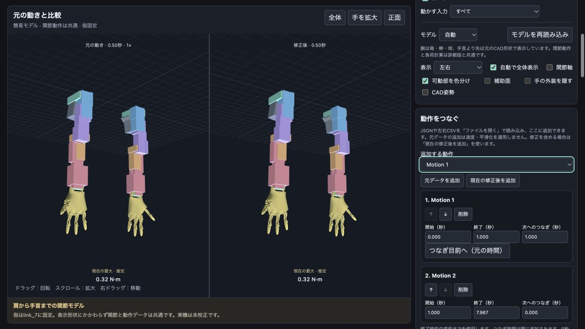

# ShosaEdit

日本語 | [English](README.en.md)

ロボットアームの記録動作を3Dで再生し、元の動きと比較しながら、左右の速度・時間差・スムージングを編集するローカルWebアプリです。編集した動きは名前を付けて再利用したり、元と同じ形式のCSVに書き出したりできます。

詳細CADを含まない簡易モデルと動作データで、そのまま起動できます。日本語・英語の表示を切り替えられます。詳細CADは別途入手してローカルに配置します。


画面の左には**両腕の元の動き**、右には**両腕の編集後の動き**を表示します。「左右の速度設定」は、この比較画面の左右ではなく、ロボットの右腕・左腕それぞれの設定です。

## 起動する

必要なものは **Python 3** と **WebGL対応ブラウザ**です。通常の利用にNode.jsやパッケージのインストールは必要ありません。

```sh
git clone https://github.com/soheiw/shosaedit.git
cd shosaedit
python3 launch.py
```

ブラウザが自動で開きます。macOSでは、フォルダ内の **起動.command** をダブルクリックしても起動できます。

- 通常のURLは `http://127.0.0.1:8765/` です。
- ポートが別のアプリに使われている場合は、空いているポートで起動します。ターミナルに表示されるURLを開いてください。
- 終了するときはターミナルで `Ctrl+C` を押します。
- HTMLファイルを直接開かず、上記のローカルサーバー経由で利用してください。

ブラウザを開かずに起動する場合や、ポートを固定する場合は次のように指定できます。

```sh
python3 launch.py --no-browser --port 8765
```

モデル・描画ライブラリ・動作データは同梱されています。再生・編集はローカルで処理し、実機への接続は行いません。

## 基本の使い方

1. **Motion 1〜3**、または「作った動き・読み込んだ動き」から動作を選びます。万歳・ウェーブ・羽ばたき・ハグなど、17種類の作成済み動作も収録しています。
2. 再生または再生バーで動きを確認します。左の元動作は1倍速、右の編集後は設定した速度で進みます。
3. 右腕・左腕の速度、ベジェ曲線、時間差、スムージングを調整します。
4. 「名前を付けて保存」でリストに追加するか、左右CSVを出力します。

スクロール中も3D表示を見られます。再生に合わせて視点が自動移動することはありません。

| 操作 | 内容 |
| --- | --- |
| ドラッグ | 視点を回転 |
| スクロール | 拡大・縮小 |
| 右ドラッグ | 視点を移動 |
| 全体 | 現在の姿勢が収まるように表示 |
| 手を拡大 | 手付近を拡大 |
| 正面 | 身体の前から見る視点へ変更 |
| Space | 再生・一時停止（入力欄にフォーカスがないとき） |
| ← / → | 経過時間を1コマ戻す・進める |

動きが画面からはみ出した場合は、その姿勢で「全体」を押してください。

## 左右別の速度と時間差


通常は右腕と左腕を別々に設定します。

- **速度倍率**：各腕を0.25〜3倍に設定できます。
- **ベジェ速度カーブ**：「編集する腕」で対象を選び、点やハンドルをドラッグします。選択した点は数値でも編集できます。横軸は元データの時間、縦軸は速度倍率です。平らな1×のカーブは等速を意味します。
- **LINK（左右共通）**：ONにすると共通の速度倍率・カーブを使います。OFFに戻すと、それまでの左右別設定に戻ります。
- **左右の時間差**：遅らせる腕と0〜5秒の待ち時間を指定します。これは速度カーブを適用した後の実時間です。

実際の速度は、腕ごとの速度倍率とカーブの値を掛け合わせて決まります。「等速に戻す」は対象のカーブを平らな1×に戻す操作で、腕の速度倍率はそのままです。LINKを切り替えても時間差は独立して適用されます。

開始を待つ腕は先頭姿勢、終了した腕は末尾姿勢を保持します。元動作と編集後の全体が終わってからループします。

再生バーと負荷グラフは**実際の経過時間**、モーター位置グラフは**元データの時間**です。速度と時間差の設定はMotionごとにブラウザへ自動保存されます。

## スムージング

| 方式 | 調整内容 |
| --- | --- |
| 自動判別（鋭い動きを残す） | 継続する動き・切り返し・関節の連動を手がかりに、動きを残す区間では平滑化を弱めます。「効き具合」で調整します。 |
| 従来の時間平均 | 前後の値をガウス重み付きで平均します。「時間窓（全幅）」を秒単位で調整します。 |

残したい動きは「残したい区間を指定」で保護できます。平滑化の時間窓と保護区間は元データの時間を基準にします。自動判別は推定であり、意図した所作を必ず保存するものではないため、比較画面で確認してください。

## 名前を付けて保存する


「修正後を保存・書き出す」で名前を入力し、**名前を付けて保存**を押します。

- 左右の速度・速度カーブ・時間差・平滑化を反映した、新しい30fpsの動作を作ります。
- ドロップダウンに追加され、その動作が選択されます。元の動作は残ります。同名がある場合は番号を付けて保存します。
- ブラウザ内の保存領域（IndexedDB）に保持し、再読み込み後も選択できます。
- 同時に **Motion JSON** をダウンロードします。

保存した動きには編集結果が織り込まれているので、初回選択時は**速度1倍・時間差なし・スムージングOFF**で開きます。元のベジェ制御点などの編集履歴を保存する機能ではありません。保存後の動きに、さらに編集を加えることはできます。

**ブラウザ内のリストとダウンロードファイルは別です。** サイトデータを消すとリストも消えます。また、ブラウザやURLのポートが変わると別の保存領域になります。再利用・移動用にJSONファイルも保管し、「ファイルを開く」から読み込んでください。

詳細表示は右腕の `private-model/model.json`・`model.bin` と、左腕の `private-model/left-model.json`・`left-model.bin` を使います。左腕はFusionの実CADから分割した独立形状で、右腕の鏡像による手先の代用ではありません。簡易表示も `public-left-hand.js` の左手形状を使い、腕だけをプリミティブにします。左腕データがない場合は鏡像の代用であることを明示します。

左手専用の質量・重心・慣性は未反映で、負荷計算の左右共通の暫定設定を継続しています。表示形状の導入は、実機の可動域・ケーブル干渉・モーター符号を検証したことを意味しません。

## 再生中のトルクグラフ

再生操作の下に、左右7軸ずつの推定トルクを固定表示します。縦軸はトルクの絶対値（N·m）、横軸は秒です。再生位置の線と現在値が動き、グラフをクリックして移動できます。関節を1つ選ぶと許容値とWARNINGの線も表示します。「元も表示（点線）」で編集前と比較できます。再計算中は古いグラフを消します。実測トルクではありません。

## TouchDesignerへのOSC / UDP送信

「OSC / UDP」パネルで受信PCのIPアドレスとポートを指定し、「送信を開始」を押します。同一LANや到達可能なネットワークが必要です。Pythonサーバーが中継するので `python3 launch.py` で起動してください。以前のサーバーは再起動が必要です。送信先はブラウザに保存しますが、送信は自動再開しません。約30fps・左右を同じシーケンス番号で送信し、一時停止中は現在姿勢を保持して送ります。ブラウザの負荷・バックグラウンド制限で送信頻度は変動します。遅れたフレームは溜めません。

TouchDesignerでは [OSC In CHOP](https://derivative.ca/UserGuide/OSC_In_CHOP) の **Network Port** を同じ番号にし、**Active** をOnにします。UDPを受け入れるネットワーク／ファイアウォール設定が必要です。送信成功表示はローカルOSへ渡したことを示し、TD側の受信確認ではありません。

| OSCアドレス | 値 |
|---|---|
| `/shosaedit/R/count/1`〜`9`、`/shosaedit/L/count/1`〜`8` | 修正後の整数モーターカウント（指の列も保持） |
| `/shosaedit/R/angle/1`〜`7`、`/shosaedit/L/angle/1`〜`7` | 現在の関節設定・基準角を適用した角度、rad |
| `/shosaedit/R/torque/1`〜`7`、`/shosaedit/L/torque/1`〜`7` | 符号付きの推定トルク、N·m |
| `/shosaedit/R/load_valid`、`/shosaedit/L/load_valid` | 計算結果が有効なら1、再計算中は0（トルク値の送信を省略） |
| `/shosaedit/time`、`/shosaedit/playing`、`/shosaedit/sequence` | 経過秒、再生中1／停止中0、連番 |

各アドレスは単一の数値を持ちます。OSC bundleは左右1パケットずつ・各1400バイト以下。速度・時間差・平滑化を適用した両腕を送ります。表示用のCAD姿勢・入力の絞り込みは適用しません。UDP送信はモーター制御ではなく、負荷ERROR中もプレビュー同様に送信します。実機へ接続する場合の安全判定は別途必要です。

元の左右CSVも `motion-data/original-csv/` に保存しています（Motion 1〜3の6ファイルと、COM14・COM15の追加記録）。元ファイルのバイト列を変更せず収録しています。

配布モーションはすべて `motion-data/` に収録しています。元のMotion 1〜3は `motions.json`、作成済み動作は `*.motion.json`、一覧は `generated-motions.json` です。

## 複数の動作を連結する

各編集パネルは見出しをクリックして折り畳めます。開閉状態はこのブラウザに保存されます。再生スライダー・再生操作・ループ切り替えは3D表示下に固定表示します。

記録ボタンはMotion 1〜9です。4〜9は初期状態では未登録です。「記録の読み込み先」で枠を選んでからMotion JSONまたは左右CSVを開くと、その枠に登録し、このブラウザに保存します。

「動作をつなぐ」で、別撮影の記録を順番に並べて1つの動作にできます。

1. 「ファイルを開く」で各撮影のMotion JSON、または左右CSVのペアを読み込みます。元記録・作成済み動作・保存済み動作も選べます。
2. 「追加する動作」を選び「元データを追加」を押します。現在の速度・時間差・平滑化も含めたい場合は「現在の修正後を追加」を使います。
3. ↑／↓で順番を入れ替え、各区間の開始・終了を秒で指定します。終了時刻は含みません。各動作の「つなぎ方」で重ね合わせ／間の補間を選び、時間を0〜10秒で指定します。重ね合わせはその分だけ全体を短縮し、間の補間は時間を追加します。0秒なら直接切り替わります。
4. 「連結してプレビュー」で全体を確認します。「つなぎ目前へ」は元の時間基準で境界の約0.5秒前へ移動します。左右別の速度や時間差を変更した後は、修正側の境界時刻は異なる場合があります。
5. 名前を付けて「連結して保存」を押すと、動作リストに追加し、Motion JSONをダウンロードします。その後は既存の左右CSV／ZIP出力も使えます。

順番・切り出し範囲・元のデータのコピーは、このブラウザに下書き保存します。再読み込みしても復元しますが、ブラウザ・ポートの変更やサイトデータの消去には引き継がれません。配布用JSONは連結済みの動作データで、元撮影ファイルの代わりにはなりません。

同じモーター列・基準姿勢のデータを使ってください。撮影間のゼロ点合わせ、IK、衝突回避は自動では行いません。つなぎは全モーター値を5次のスムーズステップで補間し、元クリップの速度まで連続になるとは限らないため、切り出し位置とつなぎ時間を画面で確認・調整してください。元の記録は変更しません。最大50区間・全体10,000フレーム（約333秒）です。


接続方法は「重ねてブレンド」と「間を補間」を選べます。重ねる場合は、前の末尾と次の先頭を指定秒数だけ重ね、両方の動きを5次スムーズステップで混ぜます。全体の時間は重ねた分だけ短くなります。重複する撮影区間の長さを手動で合わせてください。自動の位相合わせは行いません。1フレームだけの重なりや、中央の区間で前後の重なりが衝突する設定はエラーです。

「メーカーのストールトルクを入力（暫定）」で、仕様欄の選択電圧に対応するメーカー値を、型番確定済みの左右12軸へ入力できます。既定はXM540＝7.3 N·m／12 V、XM430＝4.1 N·m／12 V、XC330＝0.92 N·m／11.1 V。第5関節は型番未確定のため変更しません。暫定値のラベルと電圧も保存します。電圧を変えたらボタンを再実行します。これはストール値との比較であり、連続運転の許容値ではありません。

各軸の「許容 ストール比%」へ割合を直接入力すると、保存された電圧のストールトルクからN·mへ自動換算します。例：XM540の7.3 N·mに50%なら3.65 N·m。N·mからの入力も割合へ連動します。型番未確定の軸は％入力できません。WARNINGの％はストール比ではなく、設定した許容N·mに対する割合です。

各モーターの許容負荷は「推定負荷」の左右14軸の一覧でN·m単位で設定します。「警告割合」は既定80%で変更できます。許容値を超えるとERROR、警告割合を超えるとWARNINGを表示します。画面上部にも編集後全体の判定を表示し、速度・時間差・平滑化などの変更後に再計算します。保存・CSV/ZIP出力・連結保存は、出力する全フレームの推定負荷を再計算し、設定済みの1軸でも許容値を超えれば中止します。WARNINGは保存可能です。未設定の軸は未判定で、出力を禁止しません。指駆動は対象外です。これらは質量・慣性を含むモデルの推定判定で、実機の安全を保証しません。



## ファイルの読み込みとCSV出力

「ファイルを開く」では、次のどちらかを選べます。

| 形式 | 内容 |
| --- | --- |
| Motion JSON | 両腕を含むShosaEditの動作ファイル1つ。`format: augmented-arms-motion`、`version: 1`、`fps: 30`。 |
| CSVペア | 名前が対応する `動作名R.csv` と `動作名L.csv` を2つ同時に選択。ヘッダーなし・整数値・右9列／左8列。 |

読み込み時は1ファイル6MB以下、各腕2〜10,000フレームが対象です。読み込んだ動きをブラウザ内に残すには、名前を付けて保存してください。

CSV出力は**30fps・ヘッダーなし・整数のモーター値・右9列／左8列**です。左右それぞれ、またはペアのZIPで保存できます。両腕が終了するまで同じ行数で出力し、待機中は先頭・末尾の値を入れます。指の列も含みます。表示用のCAD姿勢や入力の絞り込みは出力に反映しません。元ファイルは変更しません。

## モーター別の負荷と許容値


「モーター別の上限比較」で、肩から手首までの**左右14軸を一度に確認**できます。R1〜R7／L1〜L7は肩からの関節番号であり、実機のモーターIDとは未照合です。指駆動は対象外です。

- 各軸の修正後の**現在トルク**、**最大値（元 → 修正）**、**実効トルク**を表示します。
- 左右各軸に運用上の**許容トルク（N·m）**を入力すると、許容値に対する修正後の最大値の比率と超過時間を表示します。
- **1軸でも超過すると、動作全体を「超過あり」と判定**します。ほかの軸の負荷が低くても相殺しません。
- 「最大比の時刻へ」で、許容値に対する最大比が最も高いモーターを選択し、その時刻へ移動します。各モーターのボタンから個別グラフも選べます。
- 超過がなくても未設定の軸がある場合は「未判定」と表示します。全軸が設定済みで超過がなければ「対象14軸は設定値内（推定）」と表示します。

許容値はブラウザに保存し、Motionを切り替えても共通で使います。値を空欄にすると未設定へ戻ります。ストールトルクは連続運転の許容値として自動入力しません。上限比較には重力と動作を合わせたトルクの絶対値を使い、超過時間は計算サンプル間の線形補間で求めます。

この判定は推定トルクの事前比較です。実機の電流・温度・保護停止の判定を再現するものではなく、実機やプレビューを自動停止する機能でもありません。

## 推定負荷の比較

CAD由来の形状、メーカーのモーター重量、仮定した部品質量を使い、重力と動作による関節トルクを推定します。個別グラフでは、選択したモーターの最大トルク・実効トルク・トルク²の時間積分を、元の動きと編集後の**同じ比較時間**で表示します。終了後の姿勢保持には重力負荷が含まれます。

- 印刷部品はPLAとして、密度1.24g/cm³・充填20%・外殻厚1.2mmを暫定値にしています。実測重量ではありません。
- 「質量・重心の設定」で仮定値や手荷物の質量を変更できます。
- 負荷の色分けは比較内の相対値です。モーターの定格に対する割合ではありません。
- トルク²の時間積分は比較指標であり、発熱量・消費エネルギーではありません。

実機での可動域・校正・ケーブル・動作中の腕全体の衝突は未検証です。推定負荷や画面の整合性を、実機動作の安全確認として扱わないでください。

## 簡易表示と詳細CADの切り替え

「モデル」で「自動」「簡易」「詳細CAD」を選べます。自動はCADがあれば詳細、なければ簡易を表示します。簡易モデルの腕は棒・球・直方体などの組み合わせです。手首より先は元のCAD形状です。主要部品のおおよその配置・寸法・太さを合わせ、穴や凹凸、ネジなどの細部を省略しています。手のひらは小さいモーター2個がある面です。関節軸・階層・基準角・動作・CSV出力は詳細CAD表示と共通ですが、細かな外観や形状による干渉は再現しません。

腕全体の詳細CADはGitHubに含めません。手首より先（link_7）のCAD形状は、公開許可を得て同梱しています。別途入手した、このアプリ用に書き出したファイルを次の場所に置き、「モデルを再読み込み」を押してください。

```text
private-model/
  model.json
  model.bin
  mass-shapes.json  # 任意：材料設定からの質量再計算用
```


`model.json`と`model.bin`は対で必要です。任意のSTLやFusionファイルの直接読み込みには対応しません。CADがない状態で「詳細CAD」を選ぶと、配置先を案内して簡易表示を続けます。英語表示では “You need to put model.json and model.bin in the private-model/ directory to display detailed CAD.” と表示します。

`private-model/`のデータはGit管理対象外です。強制追加しないでください。既存のCAD形状・CADの画面画像はmainの履歴からも除外しました。以前のクローンを持つ共同研究者は、新しくクローンしてください。

負荷計算には従来と同じリンク別の質量・重心・慣性を使い、簡易表示形状から質量を作り直しません。リンクの質量・重心はCADなしでも編集できます。PLA密度や充填率からの再計算には、任意の`mass-shapes.json`が必要です。


## モデルと関節の前提

- `link_0`〜`link_7`の関節モデルです。指・ひも周辺は`link_7`に固定しています。
- 左腕は右腕を反転した仮モデルです。詳細CADを配置すると元の部品形状を表示します。
- 入力の第1〜7列を肩から手首までに対応させ、第8・9列は保持・出力しますが、指の動作には使いません。
- 小さいモーター2個が見える面が手のひらです。「手の外装を隠す」は、この目印を照合するための表示機能です。
- 「関節の対応・基準姿勢を調整」で、入力ID、回転方向、軸、基準角を変更できます。実機との照合は別途必要です。

同梱モデル向けのプレビューであり、任意のFusionファイルやURDFを直接読み込む機能、実機制御、モーションキャプチャー入力、アプリ内でのAIによる自然言語生成は現在含みません。

## 開発と検査

描画・編集はJavaScriptとThree.js、ローカル配信はPython標準ライブラリで実装しています。ビルド工程はありません。

検査にはNode.js 20以降を使用します。外部パッケージのインストールは不要です。

```sh
npm test
```

検査対象は、左右別の再生時計、時間差、CSVサンプリング、LINK切替と設定復元、負荷計算、終了後の姿勢保持、14軸の許容値判定と超過時間・最大比の探索です。数値検査はCADの目視確認や実機検証とは別です。

| ファイル | 役割 |
| --- | --- |
| `app.js` / `index.html` / `style.css` | 画面と再生処理 |
| `speed-curve.js` / `arm-delay.js` / `smoothing.js` | 速度・時間差・平滑化 |
| `motion-sequence.js` / `sequence-editor.js` | 動作の切り出し・接続・連結下書き |
| `saved-motions.js` / `motion-files.js` / `export-motion.js` | 名前付き保存・読み込み・書き出し |
| `load-physics.js` / `load-panel.js` / `mass-model.js` / `motor-loads.js` | 負荷推定と質量モデル |
| `simple-model.js` / `simple-primitives.js` / `model-loader.js` | 基本図形による簡易表示とローカルCAD切り替え |
| `public-hand.js` | 公開許可済みの手の形状（link_7） |
| `mass-properties.json` | リンク別の質量・重心・慣性（形状を含まない） |
| `private-model/README.txt` | 別途入手するCADの配置案内 |
| `motion-data/motions.json` / `motion-data/*.motion.json` | 元記録と作成済み動作 |
| `tests/` | 数値・設定の検査 |

過去の動作再点検の範囲は[動作の再監査記録](docs/motion-reaudit.md)、所作の設計背景は[所作の研究整理](docs/shosa-research.md)を参照してください。

## ライセンスとデータ

Three.jsのライセンスは[`vendor/LICENSE-three.txt`](vendor/LICENSE-three.txt)にあります。腕全体の詳細CADは配布対象外です。公開を許可された手のCAD形状は同梱しています。動作データなどを含むリポジトリ全体に一括の再配布ライセンスは設定していません。公開・再配布時は各データの権利を確認してください。

追加記録 `marka`・`markb` は左腕＝`COM14`、右腕＝`COM15` として30 fpsで読み込みます。リストから選択できます。元CSVからの再生成は `node scripts/import-com-recordings.mjs` です。

右手首の共通基準は、2026-10-26に提供された動画とmarkaの開始姿勢に基づく暫定値（第6列3025）です。旧設定の1375はMotion 1先頭をそのまま流用しており、実物との校正値ではありませんでした。元の記録CSVは変更していません。作成済み動作の右第6列は共通基準変更に合わせて1650加算し、意図した関節軌道を保持しています。旧記録1〜3の実物姿勢との一致は未確認です。

関節の基準・軸設定は同じブラウザのタブ間で同期します。別タブの変更と、タブへ戻った時の保存設定を反映し、再生位置とカメラは保ちます。古い版を開いたままのタブは一度再読み込みしてください。CSV自体は基準角を持たないため、表示には同じ関節設定が必要です。

`markc`は、実物動画の開始姿勢に対応する表示基準を`recording-references.json`に分離しています。開始行が一致するCSVの再読み込みでも同じ基準を使います。元CSV・配布モーションの値、列順、時間軸はこの解釈修正では変更しません。左肩の横軸と左手首第7軸の向きはモデル側で調整しています。開始姿勢の完全な回旋は動画だけでは確定できず、基準合わせは暫定です。既存の生成動作すべての実機一致を保証する変更ではありません。
### 生成モーションの基準（2026-10-26）

同梱の生成17動作は、動画と照合したmarkc基準に統一しています。左第1・第7関節の軸の修正に対応し、30fpsと動作の長さを維持しています。元のMotion 1–3・marka/b/c・記録CSVは変更していません。

Motion JSONは`referenceProfile`を保存するため、平滑化後も基準を保持します。ヘッダーなしCSVには基準情報が入らないため、編集したCSVの読み込みで姿勢が違う場合は「関節の対応・基準姿勢を調整 → モデル基準」でmarkcを選んでください。過去に保存・ダウンロードした生成モーションは自動更新されません。

3種類の手の甲を上にしたウェーブは、右第3関節の端点だけ最大2カウント（約0.176°）補正し、0–4095内に収めています。値域内であることは実機の可動域・安全性の保証ではありません。実機校正・干渉は未検証です。
